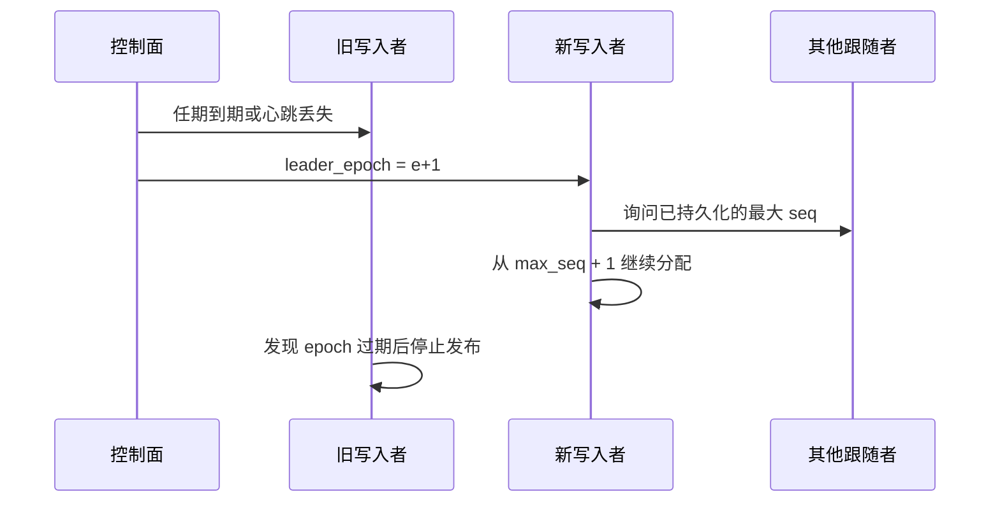

# 分布式、高可用与高并发

本文按 Redis 的主从复制写，不用 Raft 传每一行，也不用 Raft 选主。主节点有复制 ID 和已落盘偏移。副本带着 ID 和偏移来拉：对得上只收增量，对不上就全量换 WAL。16384 个槽、哨兵式多数确认、升主后改复制上游，以及多数副本确认后才对订阅者发布，都已经接上。槽位表在切换后不会自动改写。共享内存不出节点。

约束以设计第 11 节为准：一个数据集只有一个写入者，共享内存不出节点，复制走 WAL。没有演练数据之前，不写已经达到的恢复时间。

## 1. 要同时满足的三件事

| 目标 | 做法 |
|---|---|
| 高并发 | 热的交易所拆成多个分区，分区之间并行。分区内部仍然一个写入线程 |
| 高可用 | 每个分区有跟随者。写入者失效后，更大的 `leader_epoch` 从已持久化的最大 `seq` 接着分配 |
| 顺序 | 同一只股票的成交、盘口和 K 线只在一个分区里，按该分区的 `seq` 排序 |

全市场的峰值靠增加分区，不靠让同一只股票有两个写入者。查询和订阅可以打到持有该分区数据的任意节点，但要带上该节点已经应用到的 `seq`。

## 2. 两套平面

```text
控制面（小）                     数据面（大）
成员、分区表、任期、epoch    →   该分区的 WAL、内存表、本机共享内存
Raft 或同等租赁                 跟随者按 from_seq 拉 WAL 并重放
```

逐笔成交不进 Raft。Raft 只决定谁是这个分区的写入者，以及这个任期的 epoch。静态主备可以用来演练复制，不能用来防止脑裂：没有 epoch 的主备配置不能对外发布。

共享内存只映射本机。跨机器只复制 WAL 和状态快照。

## 3. 分区

### 3.1 键

分区键是 `(exchange_id, symbol_id)`。一只股票的全部行情进入同一个分区。不同交易所的股票天然分开。一个交易所超过单写入线程的吞吐时，再按 `symbol_id` 区间拆开。

符号 ID 全局分配、不复用，由元数据分区发出，并写进该分区的 WAL。业务分区不自己发明符号 ID。

每个分区有自己的 `seq`，从 1 开始，只在这个分区内严格加一。不存在跨分区的总序号。跨分区查询不做统一排序，结果里必须带 `partition_id` 和该分区的 `seq`。

### 3.2 分区表

控制面保存一张版本化的表：

| 字段 | 含义 |
|---|---|
| `map_version` | 分区表版本，单调增加 |
| `partition_id` | 分区 |
| `exchange_id` | 交易所 |
| `symbol_from` / `symbol_to` | 左闭右开的符号区间。整个交易所未拆分时，区间覆盖全表 |
| `leader_id` | 当前写入节点 |
| `leader_epoch` | 当前任期 |
| `replicas` | 持有这份数据的节点，含写入者 |

客户端和网关缓存这张表。路由用代码找到符号 ID，再找到分区，不在 SQL 文本里写节点地址。分区表变更后，旧缓存最多用到下一次请求失败或版本不符，然后重新拉取。

### 3.3 拆分

区间拆分不改已有符号的 ID，因此历史不用搬家。步骤：

1. 控制面冻结父分区的新写入，记下最后已发布的 `seq`。
2. 对这个 `seq` 做状态快照。
3. 建立两个子分区，各自用新的 `partition_id` 和新的 `leader_epoch`。符号区间拼接后等于父区间。
4. 子分区从快照恢复，接着父分区的 `seq` 继续分配。两个子分区的新序号互不重叠，因为新事件只会落在其中一个区间。
5. 父分区变为只读，保留到订阅者都改挂子分区之后再下线。

拆分期间父分区拒绝新的成交。这个停顿要可见，不把停顿期间的行情静默丢掉。把一只股票从一个分区迁到另一个不连续的区间，不在这一版设计里做。

## 4. 节点内的并发

一个节点可以领导若干分区、跟随另一些分区。分区之间不共用一把锁。

每个被领导的分区：

| 角色 | 数量 | 做什么 |
|---|---|---|
| 接入队列 | 每个上游一条 | 单生产者单消费者。只传递已经解码的定长记录 |
| 写入线程 | 一个 | 分配 `seq`、写 WAL、聚合、发布本机共享内存 |
| SQL 线程 | 多个 | 只读 `applied_seq` 当时可见的内存表 |
| 分发线程 | 一个 | 读本分区环形缓冲一次，按订阅过滤，写入各连接的有界队列 |
| 复制发送 | 一个 | 按跟随者的 `from_seq` 读 WAL 向外送 |

写入线程不跑网络运行时。Tokio 只跑接入、复制和订阅连接。慢订阅者队列满时，这条连接得到缺口并要求续传，写入线程不等待它。

同一分区的写入线程绑在一个核上是部署手段，不是正确性条件。正确性来自这个线程独占该分区的 WAL 和共享内存写映射。

节点内已经实现的单写多读、seqlock 和组提交保持不变。集群化不把这套改成跨线程抢同一只股票的锁。

## 5. 复制

### 5.1 记录

跟随者拉取的就是 WAL 记录，外加段头里的 `cluster_id`、`partition_id`、`leader_epoch`、起始 `seq`。任期更小的段被拒绝，不能应用。

应用代码与在线聚合是同一份。K 线闭合只认日志里的 `ClockTick`，跳号只认 `GapAck`。跟随者不用自己的墙上时钟补一根 K 线。

### 5.2 传输

跟随者维护 `next_seq`。写入者按序号连续推送，允许多个批次在途，应用时必须按 `seq` 重排到没有洞为止。发现洞就停在洞前，重新从 `next_seq` 请求，不把后面的记录先应用。

跟上实时之后，跟随者改收写入者的尾部推送。落后超过 WAL 保留时，先接收该 `seq` 的状态快照，再从快照之后的 WAL 续上。快照格式与单机恢复相同。

### 5.3 提交级别

| 级别 | 何时对本机订阅者可见 | 写入者故障时 |
|---|---|---|
| D0 | 本机 `fsync` 之后 | 只保证本机盘上的前缀 |
| D1 | 本机 `fsync` 之后，复制异步进行 | 尚未传到任何跟随者的尾部可以丢失 |
| D2 | 多数跟随者把该 `seq` 落入自己的 WAL 之后 | 已对订阅者可见的 `seq` 至少还在一台跟随者上 |

行情默认 D1。D2 把组提交的等待变成跨机等待，只在明确要求更少丢失时打开。跟随者的复制延迟是指标，不是写入者停顿的理由，除非级别是 D2。

## 6. 任期和切换



规则：

1. 写入权是有期限的租约。租约内必须能联系控制面并续期。联系不上就停止分配新的 `seq`，即使本机磁盘还正常。
2. 新写入者的 `leader_epoch` 更大。旧写入者收到更大的 epoch，或租约到期，就立刻停止 WAL 追加和共享内存发布。
3. 新写入者只从各副本已经 `fsync` 的最大 `seq` 之后继续。不重用任何已经出现在 WAL 里的序号。
4. D1 下，只存在于旧写入者内存、尚未 `fsync` 或尚未被任何副本收下的尾部，可以消失。订阅者看到序号不连续时走快照加续传，不把缺口当成连续成交。
5. 跟随者拒绝应用更小 epoch 的记录。两个写入者不能对同一 `seq` 写出两份载荷。

查询和订阅的响应带上 `partition_id`、`leader_epoch`、`applied_seq`。客户端发现 epoch 变了，就用上次连续收到的 `seq` 重新订阅。一条订阅只挂一个节点。不从两个节点各读一条流再合并，避免同一 `seq` 被处理两次。

## 7. 读和订阅

| 请求 | 落点 |
|---|---|
| 写入路径上的接入 | 该分区当前写入者 |
| 查询 | 任意持有该分区、且 `applied_seq` 满足调用方 `min_seq` 的节点 |
| 订阅 | 一个节点。落后或断线后用 `from_seq` 续，续传协议与单机相同 |

跟随者落后于调用方要求的 `min_seq` 时返回过期，并给出自己的 `applied_seq`。调用方可以改打写入者或等待。不提供跨分区的事务，也不提供「看全市场某一瞬间」的全局快照。需要同时看多只股票时，每只股票各自带上分区和 `seq`。

实时授权如果打到落后的跟随者，要么等待它追上，要么改打写入者。不允许把落后数据标成实时。

## 8. 故障

| 情况 | 行为 |
|---|---|
| 写入进程崩溃 | 租约到期，新任期从已持久化的最大 `seq` 继续 |
| 写入者与控制面网络隔离 | 旧写入者停止发布。新任期在仍能联系控制面的副本上产生 |
| 跟随者宕机 | 恢复后按 `from_seq` 或快照追上。D1 下不阻塞写入者 |
| 磁盘满或 WAL 写失败 | 该分区停止发布并健康检查失败。不丢弃已分配但没写盘的序号后再继续 |
| 跟随者太慢 | D1 只告警。D2 时组提交变慢，慢到超时则本批不对订阅者可见 |
| 分区表与节点不一致 | 节点拒绝自己不是领导者的写入，拒绝 epoch 不符的复制 |

元数据分区不可用时，不能分配新的符号 ID。已经分配的符号继续接收行情。

## 9. 高并发时的边界

单分区的吞吐上限是一个核加上一组 `fsync`。组提交仍是 1ms 或 256 条，先到先刷。超过这个上限的交易所必须拆分区，而不是把写入线程改成多线程抢 WAL。

全市场目标按峰值每秒百万级事件准备分区数。一个分区在演练里测到的持续写入速率，用来决定一个交易所要切成几段。文档里不写未测量的每秒笔数当成已经达到的成绩。

分发路径上，一个分区一份环形缓冲。订阅匹配在分发线程完成。连接队列默认 4096 帧，满了就缺口。查询线程只看已经用 Release 发布的表长和 `applied_seq`，不拿写入线程的锁。

接入侧每个上游一条有界队列。队列满说明写入落后于采集，指标要上升，并由采集端决定阻塞或丢弃上游包。丢弃必须变成该分区可见的缺口，不能变成更小的 `seq`。

## 10. 指标

在单机指标之外，每个分区暴露：

- `leader_epoch`、租约剩余时间
- 写入者与每个跟随者的 `durable_seq` 差、`applied_seq` 差
- 复制中断次数、任期切换次数
- 该分区组提交耗时和每秒接受的事件数
- 分区表 `map_version`

健康检查在租约过期、本分区 WAL 损坏、或 D2 等待超过配置时，对该分区返回不可用。其他分区不受这一个分区的影响。

## 11. 实现顺序

1. 一个分区、一写一跟：WAL 按 `from_seq` 复制，段头带 epoch，旧 epoch 被拒绝。
2. 控制面租约和任期。没有租约就不能发布。
3. 多分区路由和分区表。查询带 `min_seq`。
4. 跟随者从状态快照追上，再接 WAL。
5. 分区按符号区间拆分。

这五步都晚于单机 M1–M5。D2、异地灾备和股票在分区之间搬家，放在一写一跟演练通过之后。

## 12. 明确不做

- 同一 `symbol_id` 多主写入
- 用共享内存、RDMA 或缓存一致性冒充跨机总线
- 把每笔成交放进 Raft
- 跨分区事务，或全市场同一时刻的全局快照
- 从两个节点合并同一条订阅
- 没有 epoch 的静态主备对外提供写入
