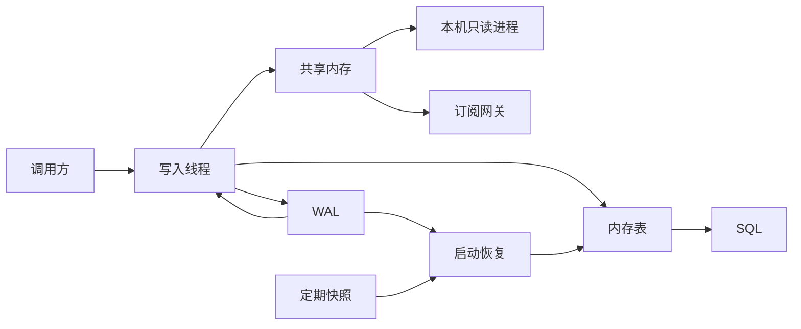
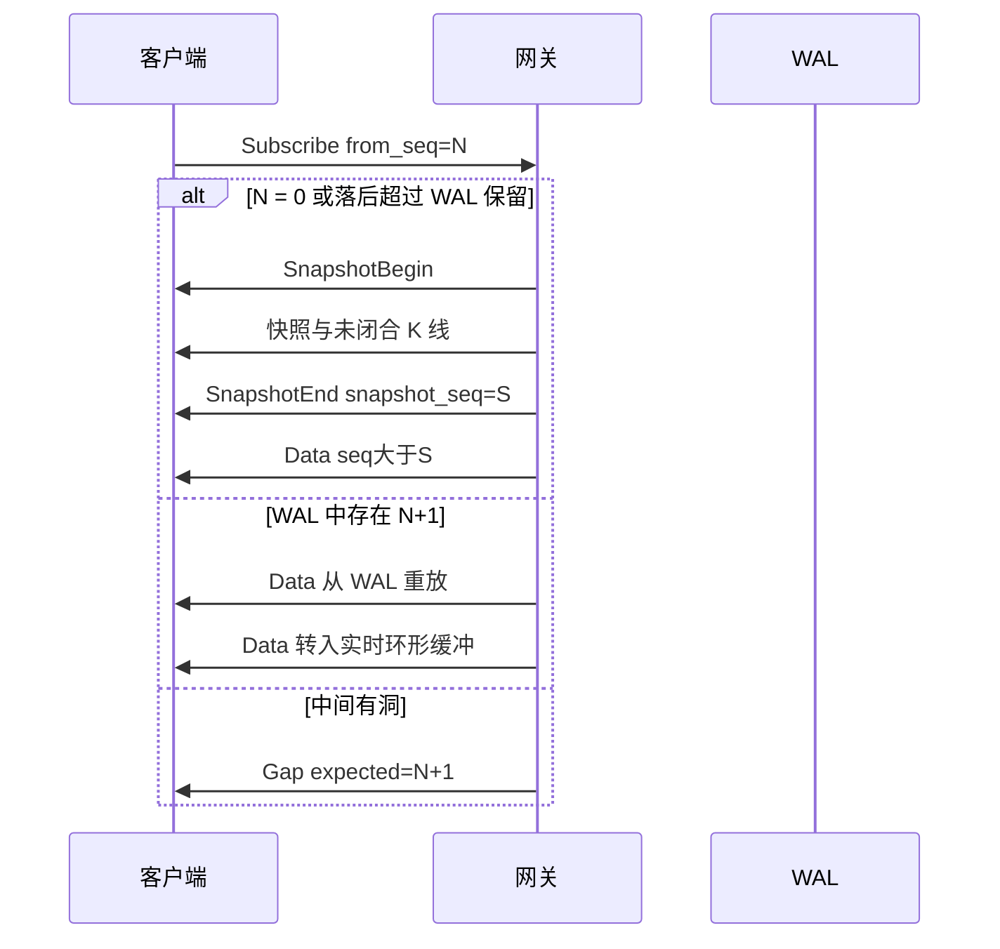
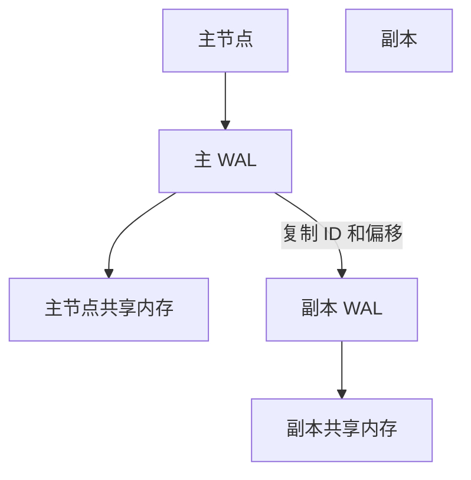

# QDB 设计

QDB 是单机优先的结构化内存数据库。同一台机器上，唯一写入进程把已提交的行写入 WAL，再更新内存表，最后发布到共享内存。查询和订阅只读。库只认识表、列、主键、追加、最新值、序号和时间。调用方决定表里放什么。行情系统是用这些表装数据的一种常见场景，不是库的模型。崩溃恢复依赖 WAL 和状态快照。共享内存只保存热数据，丢失后可以由 WAL 重建。

分布式按「分区单写 + WAL 复制」预留：共享内存不出节点。第一版只实现单机。通用内存库要求见 [2026-10-29-memory-db-requirements.md](2026-10-29-memory-db-requirements.md)。与本文冲突时以本文为准。标成「不采纳」的项不要实现。

## 1. 目标

第一版要能在单机上完成这条路径：

1. 调用方建表。表有列、主键和可选的等值索引。
2. 写入分配连续 `seq`，先落入 WAL，再更新内存表，然后发布共享内存。
3. 追加表只加新行。最新值表按主键覆盖当前行。
4. 客户端用 SQL 查询，用 `SELECT ... SUBSCRIBE` 跟着新行。
5. 进程被杀死后，从状态快照加 WAL 回到同一 `seq` 和同一批行。

延迟预算是设计目标，不是已测量结果：

- 共享内存发布之后，同机读者在微秒级看见已提交帧。
- 可见性和崩溃不丢数据绑在一起：一组记录先 `fsync` 到 WAL，再发布到共享内存。默认组提交间隔 1ms 或 256 条，先到先刷。

明确不做：

- 在引擎里命名或实现某种业务。业务用表和列表达，库不解释列的含义
- 把共享内存当跨机器传输
- 同一主键多个写入者
- 第一版实现 Raft、gRPC、完整 PostgreSQL 协议、跨表连接

### 1.1 底层能力

库是结构化的。一张表有列、主键和可选的等值索引。主键可以多列，合起来唯一。调用方决定表里放什么。

| 能力 | 要求 |
| --- | --- |
| 字典 | 表名、列、类型、主键、索引。`DESCRIBE` 读的就是这份定义，定义写入 WAL |
| 类型 | `INT64`、`STRING`、`BOOL`。数值用定点整数，不用浮点 |
| 追加表 | 行只增加。已写入的行不改，修正是新行 |
| 最新值表 | 每个主键保留当前一行，后写覆盖。订阅看见新行 |
| 序号 | 每次提交分配连续 `seq`。订阅用 `from_seq` 续 |
| 时间 | 调用方写入的 UTC 纳秒。库不解释时区、日历或间隔 |
| 读取 | `SELECT` 与 `SELECT ... SUBSCRIBE` 对每张表相同。订阅先给当前结果，再给新落盘且匹配的行 |
| 关联 | 调用方自己用相同的整型键去查多张表。库不做连接 |
| 可见性 | 读者能看见的 `seq` 已经 `fsync` |

内部编号只是调用方要的一个整数键，由库在键第一次出现时分配。库不解释这个整数代表什么。

分区、网关和每秒百万行是库的容量能力，见第 11.4 节，尚未实现。调用方用追加表、最新值表、自己选定的分区键和订阅谓词装自己的数据。

第 4 节是仓库里已经接上的一组调用方表，用来对上现有测试。它不是本库的模型，设计讨论不要从那一组表出发。以后的内核改动加在本节的表、追加、最新值和订阅上。

券商全品种、逐笔委托、订单簿、多源、权限和历史库尚未进入本设计，列在 [2026-10-19-enterprise-broker-md.md](2026-10-19-enterprise-broker-md.md)。任务没有点名时不实现。

## 2. 总体结构

三个平面分开：

| 平面 | 职责 | 第一版 |
| --- | --- | --- |
| 数据平面 | 行进入、分配 `seq`、写 WAL、更新内存表、发布共享内存 | 实现 |
| 查询平面 | SQL、最新值、追加段扫描 | 实现基础子集 |
| 控制平面 | 分区领导权、`leader_epoch`、成员 | 只占位字段 |



单机进程可以是一个二进制 `qdb`，内部仍按写入线程、SQL 线程、订阅线程拆开。共享内存区域照样创建，外部进程可以挂上来只读。这样第一版不必先做多进程部署，ABI 也不用返工。

目标部署再拆成四个角色，仍然只有一个写入者：

| 角色 | 写共享内存 | 说明 |
| --- | --- | --- |
| `qdb-ingest` | 是 | 解码、分配 `seq`、WAL、聚合、发布 |
| `qdb-sql` | 否 | 可以和 ingest 同进程。拆进程后通过只读共享内存读快照和未闭合 K 线，历史段通过本地快照文件 |
| `qdb-sub` | 否 | 从环形缓冲和 WAL 做过滤与推送 |
| 同机读者 | 否 | 只映射共享内存或走订阅 |

百万级订阅连接不进这四个角色。它们停在第 11.4 节的只读网关进程上。每个分区只向少数网关推一份已经发布的行。同机读者继续读共享内存，不占这些连接。

每台机器只运行一个 `qdb` 进程。它在打开任何库之前，用排他文件锁占住实例锁（缺省 `/tmp/qdb.instance.lock`）。锁已被占用时，第二个进程直接退出，避免两个进程同时改同一块共享内存。收到 SIGINT 或 SIGTERM 后，进程先把未落盘记录写完，卸下共享内存并清掉内存表，再释放实例锁。读者只读映射，不抢这把锁。网关是另一个进程，只读，不拿这把写锁。

一个实例目录里可以有多个库。每个库单独分配 `seq`，单独保存 WAL 和 `region.bin`。库名是字母或下划线开头的标识。已经直接写在实例根目录的 `wal/` 视为库 `default`。新建的库放在 `db/<name>/`。查询和订阅一次只打开其中一个库。

## 3. 共享内存 IPC

共享内存是同机、小端、固定布局的热总线。x86_64 和 aarch64 可用。启动时检查字节序标记，大端机器拒绝启动。

区域内不允许出现指针、`Vec`、`String`、`HashMap` 或带堆分配的结构。引擎私有内存里的索引可以用这些类型，那些结构不映射给别的进程。

### 3.1 区域

区域在创建时定长，一代之内不能扩容。要扩大容量就新建一代，`epoch` 加一，读者重新挂载。

默认容量：

| 参数 | 默认 | 说明 |
| --- | --- | --- |
| `max_symbols` | 65536 | 符号 ID 从 1 开始，0 表示无效 |
| `frame_size` | 256 | 含帧头 |
| `ring_capacity` | 65536 | 帧数，开发默认约 16MB。生产可调到 2 的幂 |
| `reader_slots` | 64 | 已注册读者，用于水位。未注册读者仍可自检 gap |
| `period_slots` | 8 | 未闭合 K 线表预留，第一版用 6 个周期 |
| 文件权限 | `0640` | 属主可写，同组只读 |

逻辑布局：

```text
[Header 4KB]
[ReaderSlot × 64，每槽独占一条缓存线]
[SymbolRec × max_symbols]
[SnapshotPod × max_symbols]
[KlinePod × max_symbols × period_slots]
[Frame × ring_capacity]
```

头部里的 offset 和 length 是权威值。读者先校验 `magic` 和 `abi_version`，再按 offset 找各段，不在代码里写死绝对地址。

头部前 128 字节是不可变元数据：

| 偏移 | 字段 | 类型 |
| --- | --- | --- |
| 0 | `magic` | `u32`，`0x5144_4231`（`QDB1`） |
| 4 | `abi_version` | `u32`，第一版为 1 |
| 8 | `endian_check` | `u32`，`0x0102_0304` |
| 12 | `frame_size` | `u32` |
| 16 | `capacity` | `u32`，2 的幂 |
| 20 | `capacity_mask` | `u32` |
| 24 | `max_symbols` | `u32` |
| 28 | `period_slots` | `u32` |
| 32 | `snapshot_stride` | `u32` |
| 36 | `flags` | `u32` |
| 48 | `symbol_off` / 各段 offset 与 length | `u64` |
| 120 | `cluster_id`、`node_id`、`partition_id` | 分布式占位，单机为 0 / 1 / 0 |

热原子量各自占一条 64 字节缓存线，避免和读者槽伪共享：

| 缓存线起点 | 字段 | 含义 |
| --- | --- | --- |
| 256 | `write_seq` | 已发布到环形缓冲的最大 `seq` |
| 320 | `durable_seq` | 已 `fsync` 的最大 `seq` |
| 384 | `applied_seq` | 内存表已可见的最大 `seq` |
| 448 | `heartbeat_ns` | 写入者存活时间，单调时钟纳秒 |
| 512 | `epoch` | 区域代际。重建区域时加一 |
| 520 | `symbol_count` | 已提交的符号目录项数 |

`write_seq == 0` 表示还没有发布过数据。有效 `seq` 从 1 开始。

读者槽：

```rust
#[repr(C, align(64))]
struct ReaderSlot {
    active: AtomicU64,       // 0 为空，否则为 reader_id
    cursor_seq: AtomicU64,   // 该读者已消费到的 seq
    heartbeat_ns: AtomicU64,
    pid: u32,
    name: [u8; 16],
}
```

注册用 CAS 抢空槽。心跳超过 3 秒的槽可以回收。写入者扫描这些槽计算最慢读者，用于水位，不根据水位停写。

### 3.2 帧

每条消息都是 256 字节。帧头 48 字节，payload 208 字节。payload 按消息类型使用固定结构，余下字节写 0。`payload_len` 表示有效字节数。

```rust
#[repr(C)]
struct FrameHeader {
    seq: u64,
    event_ts_ns: i64,
    recv_ts_ns: i64,
    payload_len: u32,
    msg_type: u16,
    flags: u16,
    symbol_id: u32,
    exchange_id: u16,
    period_id: u16,
    partition_id: u16,
    reserved: u16,
    crc32: u32,
}
```

`crc32` 覆盖帧头里 crc 字段之前的字节加上 `payload_len` 个 payload 字节。第一版校验 crc。生产若剖析显示开销过大，可以改成抽样校验，但布局保留该字段。

消息类型：

| 值 | 名称 | 含义 |
| --- | --- | --- |
| 1 | `TickTrade` | 逐笔成交 |
| 2 | `TickQuote` | 盘口快照 |
| 3 | `KlineUpdate` | 未闭合 K 线的派生通知 |
| 4 | `KlineClose` | 闭合通知 |
| 5 | `SymbolUpsert` | 新符号 |
| 6 | `ClockTick` | 某个交易所的事件时间水位 |
| 7 | `GapAck` | 写入者确认跳过一段无法补回的 seq |

标志位：

| 位 | 名称 | 含义 |
| --- | --- | --- |
| 0 | `FROM_WAL` | 这条是重放出来的，不是实时流 |
| 1 | `TS_REGRESSION` | 事件时间相对上一条同符号成交回退 |
| 2 | `CORRECTION` | 对已闭合 K 线的新修订版 |

心跳不进入环形缓冲，只更新 `heartbeat_ns`。这样静默行情不会制造假 gap，WAL 也不会被心跳撑满。

### 3.3 序列号

`seq` 是分区内输入事件的全序，由唯一写入者分配，严格加一。输入事件包括成交、报价、符号登记、`ClockTick` 和 `GapAck`。

K 线是这些事件的派生结果。未闭合 K 线携带产生它的那个 `seq`，再用 `revision` 区分同一根 K 线的多次更新。订阅通道上的顺序键是 `(seq, out_idx)`：`out_idx = 0` 是原始 Tick，其后是同一 `seq` 派生出的各周期 K 线通知。

`seq` 不按交易所时间排序。时间回退仍分配更大的 `seq`，并打上 `TS_REGRESSION`。聚合窗口看 `event_ts_ns`，流的顺序看 `seq`。

### 3.4 发布与读取

写入者只有一个线程会碰 WAL、内存表和共享内存。网络接收可以放在前面的 SPSC 队列里，出队之后才分配 `seq`。

一组记录的提交顺序：

1. 写入线程为这组事件分配连续 `seq`。
2. 追加 WAL，并 `fsync`。成功后把 `durable_seq` 设为这组最后的 `seq`（Release）。
3. 应用到内存表：符号目录、Tick 段、K 线、快照。
4. 把 `applied_seq` 设为这组最后的 `seq`（Release）。SQL 只看见小于等于该值的状态。
5. 把帧写入环形缓冲。先把槽位里的 `seq` 写成 0 并写完 payload，再对帧头 `seq` 做 Release 存储。
6. 对 `write_seq` 做 Release 存储。

第 5 步和第 6 步之间崩溃时，读者可能看到新槽位但 `write_seq` 仍是旧值，这会被当成未发布。恢复后 `seq` 从 WAL 继续，不回退。

读者：

1. Acquire 读取 `epoch`。和打开区域时看到的不同就重新挂载。
2. Acquire 读取 `write_seq` 作为 `tail`。
3. 本地 `cursor >= tail` 则没有新数据。
4. `tail - cursor >= capacity` 则被覆盖，进入 gap 路径，禁止继续逐帧猜。
5. 槽位下标是 `(cursor + 1) & capacity_mask`。Acquire 读取帧上的 `seq`。
6. `seq` 必须等于 `cursor + 1`。不相等则重试几次；仍然不相等就认定撕裂或覆盖，进入 gap 路径。
7. 拷贝 256 字节到调用方缓冲区，再次读取 `seq`。若已变化，丢弃这次拷贝并进入 gap 路径。
8. 校验 crc 和 `payload_len`。

拷贝 256 字节是读者的安全边界。调用方拿到的字节块和共享内存布局相同，不再反序列化成 `String` 或动态结构。若调用方保证在被覆盖前处理完，可以在持有槽位期间直接读映射内存；第一版 API 默认拷贝，避免策略线程把悬空引用带出轮询函数。

被覆盖的检测在读者侧完成。写入者发现慢读者只增加水位指标，不阻塞、不覆盖时等待。丢失对慢读者可见：返回 `Lapped { expected, tail, capacity }`，而不是把下一条当成连续数据。

### 3.5 快照与未闭合 K 线的版本

最新价和未闭合 K 线用 seqlock，供任意只读进程零拷贝读取。

```text
version 为奇数：写入中
version 为偶数：稳定
```

写入：`version` 加一变成奇数（Release），写字段，再加一变成偶数（Release）。

读取：Acquire 读到偶数 `v1`，读字段，再 Acquire 读 `v2`。`v1 == v2` 才使用。奇数就自旋，自旋有上限，超过后返回 `Busy`。

`version` 单调增加。快照的 `seq` 是产生该快照的输入 `seq`。读者用 `(version, seq)` 做一致性校验：读前版本和读后版本不同，整次读取作废。

符号目录只追加。写入者写完一条 `SymbolRec` 后，才 Release 增加 `symbol_count`。读者只扫描 `[0, symbol_count)`。符号 ID 不复用。

### 3.6 背压

写入路径对慢读者没有背压停顿。背压信号是显式 gap：

| 情况 | 谁发现 | 结果 |
| --- | --- | --- |
| 读者游标被环形缓冲套圈 | 读者，以及已注册槽的水位 | `Lapped`。若 WAL 仍保留该 `seq`，从 WAL 续传；否则要求先取快照 |
| 帧 `seq` 与期望不一致 | 读者 | 同上 |
| 上游行情本身缺号 | 写入者 | 聚合暂停。不把缺号前后的 Tick 合成一根看起来完整的 K 线 |
| 订阅发送队列满 | 订阅网关 | 断开该订阅者的实时流，标记 `Gap`，等它用 `from_seq` 或快照回来 |

环形缓冲使用率：

```text
usage = (write_seq - min_registered_cursor) / capacity
```

没有已注册读者时，使用率按写入者自己的 `applied_seq` 计算，只说明引擎是否跟上。指标超过 0.7 告警，超过 1 表示至少有一个注册读者已经被套圈。

## 4. 已有业务表

本节不是数据库模型。模型在第 1.1 节。这里只记录当前代码里已经存在的一套业务表，避免实现和现有测试对不上。新设计不要继续往下加业务种类。

价格和金额用 `i64` 定点。每个符号带 `price_scale` 和 `amount_scale`，表示小数位数对应的除数，例如价格 4 位小数则 `price_scale = 10000`。存储和聚合不做 `f64`。SQL 输出价格时按该符号的 scale 格式化。

时间是 UTC 纳秒 `i64`，字段名 `event_ts_ns`。这是交易所事件时间。`recv_ts_ns` 是本机收到时间，只用于延迟指标。

成交量单位是股，不是手。集合竞价成交用 Tick 标志区分，第一版不单做竞价状态机。

复权因子不进 K 线。库内保存交易所原始价。以后若要复权，另加只读因子表，查询时计算。

### 4.1 符号与交易所

代码在帧里只出现为 `symbol_id`。字符串放在符号目录的定长数组中。

```rust
#[repr(C, align(64))]
struct SymbolRec {
    symbol_id: u32,
    exchange_id: u16,
    price_scale: u16,
    amount_scale: u16,
    lot_size: u32,
    status: u16,
    code: [u8; 32],
}
```

交易所代码和符号都是调用方给出的字符串。库第一次见到某个代码时分配内部整数 ID，不维护交易所名录，也不保存时区。事件时间一律是 UTC。

`000001` 在上交所和深交所不是同一标的。SQL 和订阅使用 `EXCHANGE:CODE`，例如 `SZSE:000001`。只有在目录里全局唯一时才允许省略交易所，否则查询报歧义错误。

引擎进程内可以用 `HashMap<(exchange_id, code), symbol_id>` 做解析。这张表由符号目录重建，可以整体替换。它不进入共享内存。

### 4.2 Tick

5 档盘口可以放进单帧 payload（192 字节，小于 208）。第一版深度上限是 5。更深的盘口以后用续帧，不改变现有 Tick 布局。

```rust
#[repr(C)]
struct TickTrade {
    price: i64,
    volume: i64,
    amount: i64,
    trade_id: u64,
}

#[repr(C)]
struct TickQuote {
    last: i64,
    volume: i64,
    amount: i64,
    bid_px: [i64; 5],
    bid_qty: [i64; 5],
    ask_px: [i64; 5],
    ask_qty: [i64; 5],
}
```

Tick 只追加。成交表不更新旧行。报价更新的是快照槽，同时追加一条 `TickQuote` 事件，供订阅和审计使用。

内存里的 Tick 表按 `symbol_id` 分片，每片是按 `seq` 排列的行段：

```text
Segment { symbol_id, start_seq, end_seq, start_ts, end_ts, rows: Vec<TickRow> }
```

这是引擎私有内存。环形缓冲被覆盖之后，SQL 仍能查询保留窗口内的 Tick。默认保留最近 2 小时，可配置。超出保留窗口的 Tick 查询返回 `RetentionExceeded`，不静默截断。更早的数据留在 WAL 保留期内，供恢复和续传，不保证都能被 SQL 扫到。

同一 `(exchange_id, trade_id)` 在去重窗口内出现两次时，第二次不分配新 `seq`。去重窗口默认 65536 条或 60 秒。

### 4.3 K 线

周期：

| `period_id` | 名称 | 对齐 |
| --- | --- | --- |
| 1 | `1s` | 交易所当地时间，按秒取整 |
| 60 | `1m` | 按分钟取整 |
| 300 | `5m` | 按 5 分钟取整 |
| 900 | `15m` | 按 15 分钟取整 |
| 3600 | `1h` | 按小时取整 |
| 14400 | `4h` | 按 4 小时取整。连续交易常用 |
| 65535 | `1d` | 有时段的市场按交易所当地交易日。`BINANCE` 按 UTC 自然日。86400 超出帧头 `u16`，用 `u16::MAX` 表示 |

事件时间是 UTC 纳秒。`1d` 和分钟线都按 UTC 取桶。业务系统若要按某个交易所的本地日期切线，先把时间换算成对应的 UTC 再写入。需要收线时由业务系统写入 `ClockTick`。

```rust
#[repr(C, align(64))]
struct KlinePod {
    version: AtomicU64,
    seq: u64,
    bucket_start_ns: i64,
    symbol_id: u32,
    exchange_id: u16,
    period_id: u16,
    state: u8,       // 0 未闭合，1 已闭合
    origin: u8,      // 0 实时派生，1 导入，2 修订
    revision: u16,
    open: i64,
    high: i64,
    low: i64,
    close: i64,
    volume: i64,
    amount: i64,
    tick_count: u32,
    flags: u32,      // bit0: incomplete，中间有 GapAck
}
```

未闭合 K 线放在共享内存的二维表 `[symbol_id][period_index]`，每个周期每只股票最多一根。已闭合 K 线追加到引擎私有的按 `(symbol_id, period_id)` 排序的段里，不在原槽改写。

修订已闭合 K 线时追加一根相同 `bucket_start_ns`、更大 `revision` 的记录。查询取该桶最大 `revision`。旧修订保留，直到快照压缩。`origin = import` 的桶不会被实时 Tick 改写；晚到的 Tick 记为异常。

### 4.4 快照

```rust
#[repr(C, align(64))]
struct SnapshotPod {
    version: AtomicU64,
    seq: u64,
    event_ts_ns: i64,
    recv_ts_ns: i64,
    symbol_id: u32,
    exchange_id: u16,
    depth: u16,
    last: i64,
    volume: i64,
    amount: i64,
    bid_px: [i64; 5],
    bid_qty: [i64; 5],
    ask_px: [i64; 5],
    ask_qty: [i64; 5],
}
```

下标就是 `symbol_id`。`TickTrade` 更新 `last`、累计量和额。`TickQuote` 更新五档和最新价。读取协议见 3.5。

### 4.5 只追加规则

| 数据 | 规则 |
| --- | --- |
| Tick 段 | 只追加。保留期到期整段丢掉 |
| 未闭合 K 线 | 允许在自己的槽里更新，`version` 每次加二（seqlock 的两次加一） |
| 已闭合 K 线 | 不覆盖。修正是新 `revision` |
| 快照 | 每个符号一个槽，允许覆盖，靠 `version` 防止读到半写 |
| 符号 | 只追加。状态变化追加一条新记录并更新引擎侧当前指针；第一版状态只有活跃一种，目录项不可变 |
| WAL | 只追加 |

## 5. SQL

第一版语法是固定子集，手写递归下降解析，不接入通用 SQL 解析器。这样语法边界就是代码边界。

```text
statement   = query
query       = primary { setop primary }
              ["ORDER BY" order] ["LIMIT" integer]
primary     = select | "(" query ")"
setop       = ("UNION" | "INTERSECT" | "EXCEPT") ["ALL"]
select      = "SELECT" ["DISTINCT"] projection "FROM" from_item
              ["WHERE" expr] ["GROUP BY" group] ["HAVING" expr]
projection  = "*" | item { "," item }
item        = agg "(" ident ")" ["AS" ident] | value ["AS" ident]
agg         = "MAX" | "MIN" | "SUM" | "AVG" | "FIRST" | "LAST" | "COUNT"
expr        = or
or          = and { "OR" and }
and         = not { "AND" not }
not         = ["NOT"] cmp
cmp         = value [comp value | "BETWEEN" value "AND" value
            | ["NOT"] "IN" "(" value { "," value } ")"
            | ["NOT"] "LIKE" value
            | "IS" ["NOT"] "NULL"]
value       = add
add         = mul { ("+" | "-") mul }
mul         = unary { ("*" | "/") unary }
unary       = ["-"] primary
primary     = ident | literal | "(" expr ")"
            | "CASE" when { when } ["ELSE" value] "END"
when        = "WHEN" expr "THEN" value
comp        = "=" | "<>" | "!=" | "<" | "<=" | ">" | ">="
group       = value { "," value }
order       = ident ["ASC" | "DESC"] { "," ident ["ASC" | "DESC"] }
```

不支持子查询、窗口函数、`WITH` 和 `UPDATE`。`DELETE` 只对调用方建成、并且带主键的表生效。单个键写成各主键列的等值，用 `AND` 连起来。单列主键还可以写成 `IN`，一次删多个值。复合主键写成 `(列, ...) IN ((值, ...), ...)`，列必须恰好是全部主键，顺序不限，值的顺序跟写出的列一致。列表为空、有重复键或其中某个键不可见时，整句不写。`INSERT` 可以在表名后写出全部列，顺序不限，值按这个顺序填写；清单必须是建表列的一个排列，缺列、重复列或未知列整句不写。也可以在 `VALUES` 后写多个元组。先检查每一行，再逐行提交：某一行类型不对、主键已经可见，或同一句里主键重复，整句不写。多个元组不能带 `EXPECT`。句末一个 `EXPIRE AT` 作用在这一句的每一行上。`INSERT ... EXPECT n` 只用于单个元组，并且只有在该主键当前可见序号等于 `n` 时才写入：`0` 表示键必须还不存在，大于 0 表示覆盖这一行。不符则不写。`EXPIRE AT` 的水位是调用方给出的 UTC 纳秒，不是本机时钟。截止时间非 0 且不晚于水位的可见主键各追加一条墓碑。没有截止时间的行保留。查询调用方建成的表时，结果多一列 `seq`，它不是建表时的列，而是这条可见行的提交序号。

```text
delete      = "DELETE" "FROM" table "WHERE" ident "=" literal
              { "AND" ident "=" literal }
            | "DELETE" "FROM" table "WHERE" ident "IN" "(" literal { "," literal } ")"
            | "DELETE" "FROM" table "WHERE" "(" ident { "," ident } ")"
              "IN" "(" row { "," row } ")"
row         = "(" literal { "," literal } ")"
```

`FROM` 可以是任何已登记的表。`JOIN` 见下一节。写入来自调用方提交、恢复和这种墓碑。四则运算只用整数，除法向零截断，不用浮点。`LIKE` 里 `%` 匹配任意长度，`_` 匹配一个字符，`\` 转义。`CASE` 只接受 `WHEN` 条件这种写法。

`FROM` 之后可以接 PostgreSQL 风格的连接。`JOIN` 与 `INNER JOIN` 相同，只保留两边都匹配的行。`LEFT JOIN` 保留左表全部行，右边没有匹配时那些列为空文本。`RIGHT JOIN` 相反。`FULL JOIN` 两边都保留。`ON` 是等值条件，多个条件用 `AND`。`NULL` 不等于 `NULL`，空文本对空文本仍然相等。结果先按左表顺序，再补上没有配上的右表行。多表时 `*` 的列名是 `别名.列名`。不支持连接上的聚合。

```text
from_item   = table [alias] { join }
table       = ident
join        = ["INNER"] "JOIN" table [alias] "ON" eq { "AND" eq }
            | "LEFT" ["OUTER"] "JOIN" table [alias] "ON" eq { "AND" eq }
            | "RIGHT" ["OUTER"] "JOIN" table [alias] "ON" eq { "AND" eq }
            | "FULL" ["OUTER"] "JOIN" table [alias] "ON" eq { "AND" eq }
            | "CROSS" "JOIN" table [alias]
alias       = ["AS"] ident
eq          = qual "=" qual
qual        = ident "." ident
```

```sql
SELECT a.id, b.name
FROM account AS a
INNER JOIN note AS b ON a.id = b.id
WHERE b.active = true
LIMIT 100;
```

标识符和字符串用单引号字面量。绑定参数放到后续协议阶段；第一版 SQL 文本里直接写字面量。

### 5.1 表

| 表 | 必要过滤 | 内容 |
| --- | --- | --- |
| `ticks` | `symbol` 可省略；省略时返回全部代码，并用 `LIMIT` 截断 | 保留窗口内的逐笔 |
| `klines` | `symbol` 和 `period` | 已闭合段加一根未闭合 |
| `snapshots` | 可选 `symbol` | 最新价和五档。无 `WHERE` 时必须有 `LIMIT` |
| `symbols` | 无 | 符号目录 |

时间列名是 `ts`，类型为事件时间。也接受 `seq` 过滤。

`klines.period` 取 `1s`、`1m`、`5m`、`15m`、`1h`、`1d`。

示例：

```sql
SELECT ts, open, high, low, close, volume, amount, seq
FROM klines
WHERE symbol = 'SZSE:000001' AND period = '1m' AND ts BETWEEN 1710000000000000000 AND 1710086400000000000
ORDER BY ts ASC
LIMIT 500;

SELECT last, bid_px1, ask_px1, seq
FROM snapshots
WHERE symbol = 'SZSE:000001';
```

`SELECT` 列表里的 `bid_px1` 到 `bid_px5` 对应数组槽位，避免第一版做数组语法。

没有 `LIMIT` 时默认 1000，硬上限 100000。超过硬上限返回错误，要求调用方缩小范围。

### 5.2 执行

1. 解析并校验聚合是否出现在允许的位置。有 `GROUP BY` 时，选择列表里的非聚合列必须出现在分组键中。
2. 解析 `symbol`，得到 `symbol_id`。scale 不同的符号不能出现在同一个 `SUM` / `AVG` 里，除非按 `symbol` 分组。
3. `klines` 对 `(symbol_id, period_id, bucket_start_ns)` 二分。`ticks` 对时间二分。`snapshots` 直接读 seqlock 槽。
4. 查询开始时 Acquire 读取 `applied_seq`。扫描跳过 `seq` 更大的行。未闭合 K 线和快照若 `seq` 更大，或 seqlock 失败，重试最多 3 次，仍失败则返回 `Busy`。
5. `WHERE` 支持 `AND` / `OR` / `NOT`、比较、四则运算、`CASE`、`IN`、`LIKE`、`BETWEEN` 和 `IS NULL`。`symbol` 与 `period` 写在最外层 `AND` 上，供扫描使用。
6. 有 `GROUP BY` 时按分组键各出一行。分组键可以是表达式。没有分组的聚合仍是一行。选择列表里的非聚合表达式必须出现在分组键中。`HAVING` 过滤分组结果。
7. `DISTINCT` 去掉重复行。`UNION` 去掉整行重复，`UNION ALL` 保留。`INTERSECT` 只留两边都有的行，`EXCEPT` 从左边去掉右边有的行。带 `ALL` 时按出现次数，否则整行文本相同只留一次。`INTERSECT` 比 `UNION` 和 `EXCEPT` 更紧，只连接相邻的操作数。括号先算出里面的结果，里面的 `ORDER BY` 和 `LIMIT` 也先生效。`ORDER BY` 和 `LIMIT` 作用在整段结果上。整数按数值比，其余按文本比。`FIRST` / `LAST` 按组内存储顺序。
8. `SUM` 用 `i128` 累加，溢出返回错误。`AVG` 返回十进制文本，不使用二进制浮点。

和 PostgreSQL 的差别：没有子查询、`WITH`、窗口函数。连接产生的空值显示为空文本。表达式结果是整数文本。

空结果是零行，不是错误。符号不存在是错误。

### 5.3 PostgreSQL 接口

对外目标是 PostgreSQL 线协议的简单查询：启动消息、`Query`（`Q`）、`RowDescription`、`DataRow`、`CommandComplete`、`ErrorResponse`、`ReadyForQuery`。端口默认 `5433`。认证第一版只接受本机 `trust`。

结果里的整数是 `int8`，价格和 `AVG` 是 `numeric` 的文本编码，时间是 `int8` 纳秒。不在第一版实现扩展查询（Parse / Bind / Execute）、COPY、LISTEN/NOTIFY、`information_schema`。

第一版查询路径是进程内 API 加上一个行文本协议，供测试使用。PostgreSQL 编解码放在独立模块 `qdb-pgwire`，避免引擎依赖线协议。功能开关默认关闭。

文本协议仅用于开发和验收：

```text
Q <sql>\n
ROW <column>\t...\n
END <row_count>\n
ERR <code> <message>\n
```

### 5.4 命令行客户端

`qdb-client` 用只读方式打开数据目录。它重放 `wal/wal-1.qwal`，不创建、不删除 `region.bin`，不追加 WAL，因此可以和写入进程同时看已经 `fsync` 的数据。普通查询每条语句重新打开一次。

`.watch` 先打印该表的当前行，再从上次读到的位置跟随新 `fsync` 的记录。`snapshots` 看最新价、买一和卖一，`ticks` 看逐笔，`klines` 还要给周期。这是本机轮询，不是网络推送。

`SELECT` 末尾的 `SUBSCRIBE` 把这条查询变成订阅读取。客户端先按这条 `SELECT` 打印当前结果，再跟随新 `fsync` 的记录，把匹配的新行按同一列顺序打印。`LIMIT` 只约束第一屏。聚合在匹配变更到达后重算，值变了才再打印一行。`Ctrl-C` 结束。没有网络推送。

```sql
SELECT last, bid_px1, ask_px1, seq
FROM snapshots
WHERE symbol = 'SSE:600000' SUBSCRIBE
```

除第 5 节的 `SELECT` 外，客户端接受：

```text
show      = "SHOW" "TABLES"
describe  = "DESCRIBE" table | "DESC" table
```

`SHOW TABLES` 列出四张逻辑表和必要过滤。`DESCRIBE` 列出该表当前查询能返回的列。点命令 `.tables`、`.schema`、`.help`、`.quit` 是上述语句的快捷方式。

没有查询用的网络端口。PostgreSQL 线协议和上面的行文本协议仍不在本版本。

### 5.5 建表

用户表和行情四张表分开。`symbols`、`ticks`、`snapshots`、`klines` 不能被 `CREATE TABLE` 覆盖。

支持的字段类型只有三种，都按小端写入 WAL，不使用浮点：

| 类型 | 含义 |
| --- | --- |
| `INT64` | 有符号 64 位整数。价格、数量、时间和序号用它 |
| `STRING` | UTF-8 文本，最长 1024 字节 |
| `BOOL` | `true` 或 `false` |

一张表至少一列。`PRIMARY KEY` 可以标在多列上，这几列合起来唯一。主键重复时插入失败。`INDEX 索引名 (列)` 是二级索引，不要求唯一，只用于等值查找。没有索引的列仍可在 `WHERE` 里过滤，实现会扫描全表。

已有的那四张业务表用同一套列、主键和索引登记，行也放在普通表里。`SELECT` 读的就是这些行。写入仍由现有的写入路径完成，不接受 `INSERT`，也不能被 `CREATE TABLE` 覆盖。主键已存在时覆盖该行，用来表达「每个键当前一行」。

```text
CREATE TABLE name (
  id INT64 PRIMARY KEY,
  code STRING,
  active BOOL,
  INDEX idx_code (code)
)
INSERT INTO name VALUES (1, 'SSE:600000', true)
SELECT * FROM name WHERE code = 'SSE:600000'
```

不写列清单时，值的顺序与建表列顺序一致。写了列清单时，先按清单排列再排回建表顺序，然后才写入。建表和插入各占一个 `seq`，类型号分别是 8 和 9。没有默认值，列清单不能少列。定义写在 WAL 里，重启后仍在。共享内存帧只发布表名；完整定义以 WAL 为准。

`qdb` 进程的组提交是 256 条或 1ms，一次 `fsync` 后才发布这批帧。库接口默认仍是每条 `fsync`。`qdb` 的共享内存用 65536 个符号槽和 65536 帧。报价保存五档价格和数量。`snap/checkpoint.qsnap` 记下已应用状态和 WAL 位置；下次打开先装入检查点，再重放之后的记录。检查点不可用时仍全量重放 WAL。

## 6. 订阅

发布模型：写入者把已提交帧放进环形缓冲后，所有跟上的读者都能看见。过滤在订阅网关做。共享内存读者自己过滤。

### 6.1 过滤

订阅键：

```text
exchange_id   可选，0 表示全部
symbol_id     可选，0 表示全部
period_id     可选，0 表示该过滤下的全部消息
msg_mask      Tick、K 线、快照通知的组合
from_seq      希望收到的下一条 seq。0 表示从当前快照开始
```

第一版每个 TCP 连接一个过滤条件。同一连接上的多过滤以后再加。

### 6.2 传输

| 传输 | 阶段 | 行为 |
| --- | --- | --- |
| 共享内存 | 第一版 | 读者自己维护 `cursor`，按 3.4 读帧 |
| TCP 长度前缀帧 | 第一版 | 网关过滤后推送，payload 与共享内存帧相同 |
| WebSocket 文本 | 已实现 | `GET /v1/ws`。客户端发一条 `SELECT`。每个库一个跟随线程读已经 `fsync` 的 WAL，空闲时大约 1 毫秒一次。同一批变更里相同的增量查询只投影一次。服务端先推当前结果，再推新行。慢连接的队列默认 4096 条，满了只向该连接发 `{"type":"gap"}` 并关闭，不挡住写入和其他订阅 |
| gRPC server stream | 后续 | 同一套字段的 protobuf 映射 |

TCP 帧：

```text
u32 length | u16 type | u16 flags | body
```

`length` 含 type 和 flags。类型：`Hello`、`Subscribe`、`SnapshotBegin`、`SnapshotRow`、`SnapshotEnd`、`Data`、`Gap`、`Error`。`Data` 的 body 就是 256 字节共享内存帧。

同一连接上，`Data` 按 `(seq, out_idx)` 递增。网关不允许为了合并小包而重排。

### 6.3 断点续传



快照消息带 `snapshot_seq`。随后只发送 `seq > snapshot_seq` 的增量。客户端把本连接最后连续 `seq` 作为下次的 `from_seq`。

重放出来的帧带 `FROM_WAL`。实时帧不带。切换点不重复、不跳号。若实时环形缓冲在重放期间把续传点覆盖掉，网关重新从 WAL 定位，不对客户端发出有洞的序列。

客户端若收到 `Gap`，应停止使用这条流上的后续帧做连续计算，直到新的 `SnapshotEnd`。

### 6.4 网关内部

网关按库跟随已经 `fsync` 的 WAL，匹配订阅者，写入每个订阅者的有界队列。WebSocket 使用这条路径：空闲时大约每 1 毫秒读一次，同一条增量 `SELECT` 在一批变更里只投影一次。队列默认 4096 条，可用 `QDB_WS_QUEUE` 调整，至少为 1。队列满时清空该连接的待发消息，放入一条 `{"type":"gap"}` 并关闭它，不减慢跟随线程，也不增加 `qdb_gap_total`。慢订阅者不让 `/health` 变成 503。

WAL 重放使用单独的发送循环，补到 `write_seq` 之后再切入实时匹配。一个订阅者在重放完成前不接收实时帧，避免新旧交叉。

上面是已经接上的单机路径，测到的 WebSocket 并发是 128 条连接。每秒百万行和百万订阅连接的目标形态在第 11.4 节，网关进程还没有。现在不要把「每个库一个跟随线程直接对终端读 WAL」当成那两条目标的完成态。

## 7. K 线聚合

聚合器跑在写入线程上，输入是已经写入 WAL 的事件。同一 `seq` 的全部周期更新完成后，才增加 `applied_seq` 并发布帧。

### 7.1 状态

每个 `(symbol_id, period_id)` 有：

- 最多一根未闭合 K 线
- `last_applied_seq`
- 已闭合段

另有每个 `exchange_id` 的事件时间水位 `watermark_ns`，只由 `ClockTick` 和该交易所 Tick 推进。一只股票的时间不关闭另一家交易所的 K 线。

### 7.2 算法

对一条 `TickTrade`：

```text
if tick.seq <= last_applied_seq:
    return                    # 重复重放
if tick.seq != last_applied_seq + 1:
    pause until GapAck        # 缺号，不闭合、不修改未闭合 K 线

for period in configured_periods:
    bucket = align(period, tick.event_ts, exchange)
    bar = open_bar(symbol, period)
    if bar exists and tick.event_ts < bar.bucket_start:
        record late_tick      # 已过去的桶，默认丢弃该 Tick 对这个周期的影响
        continue
    if bar exists and bucket != bar.bucket_start:
        seal(bar)
        bar = None
    if bar is None:
        bar = new_bar(tick, bucket)
    else:
        bar.high = max(bar.high, tick.price)
        bar.low = min(bar.low, tick.price)
        bar.close = tick.price
        bar.volume += tick.volume
        bar.amount += tick.amount
        bar.tick_count += 1
        bar.seq = tick.seq
publish updates
```

`seal` 把未闭合槽标成闭合，追加到已闭合段，然后清空该槽的“当前桶”身份。共享内存里可以暂时留着最后一根闭合结果供读取，但 `state = closed` 后聚合器不再改它的 OHLC。下一根未闭合 K 线使用新的 seqlock 写进入槽。

`TickQuote` 不推动 OHLC 成交量。它只更新快照。若报价里的最新价需要推动 K 线，由采集端额外发送 `TickTrade` 或带成交标志的事件。第一版不从报价推断成交。

### 7.3 闭合

K 线在两种日志事件下闭合：

1. 同一周期出现下一个桶的 Tick。
2. 该交易所的 `ClockTick.watermark_ns` 大于等于桶的结束时间。

`ClockTick` 由写入者写入 WAL，默认每 200ms 至多一条，且水位取该交易所已见事件时间减去 `grace`。`grace` 默认 0。跟随者只重放 `ClockTick`，不用自己的墙上时钟闭合 K 线。这样重放和以后的副本结果一致。

迟到 Tick：事件时间落入已经闭合的桶时，默认丢弃其对 K 线的影响，计数 `late_tick_total`，原始 Tick 仍保留在 Tick 表。改为修订闭合 K 线必须由显式修正命令产生新 `revision`，第一版可以没有这条命令，但存储要能放下 `revision`。

### 7.4 多周期与幂等

一条成交在同一次应用里更新全部已配置周期：`1s`、`1m`、`5m`、`15m`、`1h`、`1d`。任一周期的更新失败则整个 `seq` 不算已应用，进程应停止写入并保留 WAL，避免周期之间永久分叉。

幂等来自 `last_applied_seq`：

- 相同 `seq` 再来一次：状态不变。
- 从快照的 `applied_seq` 之后重放 WAL：得到同一未闭合 K 线和同一已闭合序列。
- 转储文件 `QDBDUMP1` 是某一库已提交 WAL 记录的副本。恢复写回空库的 WAL，打开后得到同一 `seq` 和同一组 K 线。回放则按记录顺序重新写入，分配新的 `seq`，用来把这段行情再放一遍。
- 聚合只依赖 WAL 里的事件和快照里的聚合状态，不依赖墙上时钟，不依赖 `HashMap` 的迭代顺序。

缺号时暂停。运维确认无法补数后，写入一条 `GapAck { missing_from, missing_to }`。它占用这些 `seq`，并把受影响的未闭合 K 线标成 `incomplete`。副本重放同一条 `GapAck`，不会各自决定是否跳过。

### 7.5 示例

三笔 `SZSE:000001` 成交，`1s` 与 `1m` 同时聚合：

| seq | 事件时间 | 价格 | 量 |
| --- | --- | --- | --- |
| 1 | 09:30:00.100 | 10 | 100 |
| 2 | 09:30:00.200 | 12 | 50 |
| 3 | 09:30:01.000 | 11 | 10 |

处理完 `seq=2` 时，`1s` 和 `1m` 都是未闭合：`O=10 H=12 L=10 C=12 V=150`。

`seq=3` 落入下一秒，先闭合 `1s` 桶 `[09:30:00, 09:30:01)` 为上述 OHLC，再打开新的 `1s` 桶 `O=H=L=C=11 V=10`。`1m` 桶仍未闭合，变成 `O=10 H=12 L=10 C=11 V=160`。

从空状态重放 `seq` 1 到 3，结果相同。只重放 `seq=2` 时，因 `last_applied_seq` 已是 3，状态不变。若只收到 1 和 3，聚合停在 `seq=1`，不闭合那根 `1s` K 线。

## 8. 并发与一致性

| 规则 | 实现 |
| --- | --- |
| 单写多读 | 文件锁外加设计约束。读路径没有锁等待写入者 |
| 读者不阻塞写入 | 环形缓冲覆盖最慢读者，读者得到 `Lapped` |
| 全序 | 分区内 `seq` 严格加一。第一版单机把所有交易所放在同一个分区 |
| 快照一致读 | seqlock 的前后 `version` 必须相同 |
| 跨进程可见 | 提交字用 Release 存储，读者用 Acquire 加载。依赖同机缓存一致性。不把共享内存映射到其他机器 |
| 查询稳定边界 | SQL 使用读取开始时的 `applied_seq` |
| 乱序与回退 | `seq` 回退或跳跃：帧级报 `SeqRegression` / `SeqGap`；事件时间回退只打标志，不打乱 `seq` |

内存顺序只用 Acquire / Release。不在热路径使用 `SeqCst`。

写入线程之外 nobody 修改这一份 WAL 上的 K 线槽、快照槽和环形缓冲。SQL 线程、订阅线程和外部进程只读。

### 8.1 写入者能不能加

压测里慢，是因为一条 WAL 上的 `fsync`，不是因为只有一个线程在算。2026-10-28 在开发笔记本上用 release 跑 `qdb-load`：1 个写入者、32 只证券、128 个订阅同时读这份 WAL、组提交 256 条或 1 毫秒。正式 20000 笔约 264 笔/秒，成交 p99 约 195 毫秒。1 毫秒先到，一批往往只有几条就刷盘，落盘次数远多于 `笔数/256`。

同一份 WAL、同一个 `seq`、同一块共享内存上再加写入线程，不会并行刷盘。序号必须严格加一，文件只有一个写偏移，帧槽只有一个发布者。多个线程会在这三处排队，延迟更高，还会把全序写乱。

要提高吞吐，按下面的顺序做，不要改成多线程写同一份日志：

1. 先调组提交。间隔是可见性上限，条数是一批的体积。券商如果接受几毫秒才可见，把间隔调大，让 256 条先凑满，`fsync` 次数就下来。这是配置，不改 `abi_version`。
2. 再按分区加写入者。一个分区一份 WAL、一段连续 `seq`、一块只属于它的共享内存，由一个写入线程独占。分区按交易所切就够做第一步：上交所、深交所、北交所、港股、币安各一个。它们的 `fsync` 可以同时进行。一只证券仍然只属于一个分区。
3. 一个 `qdb` 进程可以持有多个分区的写映射。第二台机器上的进程仍然不能写这些映射。查询按 `EXCHANGE:CODE` 找到分区，不提供跨分区事务。

订阅人数不增加写入吞吐。128 个订阅同时读同一份 WAL，会和刷盘抢磁盘。订阅扩容是多读，写入扩容是多分区。

### 8.2 量化交易怎么用

量化在乎两段时间，不要合成一个数。

| 时间 | 从哪到哪 | 策略用来做什么 |
|---|---|---|
| 信号延迟 | 这笔成交进入写入者，到同机策略读到已发布的价 | 决定下不下一笔 |
| 可重放延迟 | 同一笔已经 `fsync`，崩溃后按 `seq` 还能见到 | 实盘和回放必须对得上 |

本库把这两段绑在一起：没刷盘的 `seq` 不发布。不能为了让策略更早看到价，改成内存先可见、盘上还没有。那样策略用过的价在崩溃后消失，回放对不上实盘。

2026-10-28 的压测慢，是因为 128 个订阅各自读 WAL，和刷盘抢同一块盘。量化席位不该这样接。同机策略读共享内存里的快照槽和环形缓冲，一次只读已发布的 `seq`。全市场订阅由一个跟随线程读，再分到各策略的队列。慢策略只把自己标成缺口，不拖写入，也不拖别人。SQL 用来核对和复盘，不放在下单热路径上。

热路径上的优化按这个顺序，仍然是一个分区一个写入者：

1. 订阅离开 WAL。策略读共享内存；对外推送只留一个跟随线程。这一步不改组提交，先把 128 份读盘拿掉。
2. 交易簿和全市场分开两个分区。策略真正交易的那几十只用较短的组提交间隔。只做记录的全市场用较大间隔，凑满再刷。热门名字不再排在没人交易的刷盘后面。
3. 其余交易所再各自分区，各刷各的盘。一只证券只在一个分区里。
4. 间隔仍是配置。想要更低的信号延迟，就接受更多次 `fsync`；想要更高吞吐，就把间隔放宽。两条不能同时在同一分区上取极值。

同一台笔记本、同一次 `qdb-load` 上的对照（2026-10-28，三轮取成交 p99 居中的一轮，128/128 都跟上）：

| 接法 | 墙钟 | 混合吞吐 | 成交 p99 | 报价 p99 | 落盘次数 |
|---|---|---|---|---|---|
| 128 个订阅各自读 WAL | 70.6 秒 | 283 笔/秒 | 156 毫秒 | 3.4 毫秒 | 5112 |
| 一个跟随线程读 WAL，策略不读盘 | 14.1 秒 | 1423 笔/秒 | 4.7 毫秒 | 1.3 毫秒 | 3645 |
| 上交所、深交所各一个写入者，各一个跟随线程 | 17.3 秒 | 1155 笔/秒 | 6.9 毫秒 | 7.2 毫秒 | 6061 |

先拿掉 127 个读盘的订阅，吞吐大约到 5 倍，成交 p99 从 156 毫秒降到 4.7 毫秒。在这块盘上再拆两个交易所没有更快：两份 WAL 同时 `fsync`，报价 p99 反而从 1.3 毫秒升到 7.2 毫秒。交易所分区要等盘能并行刷，或者写到另一台机器，才算第 3 步。这一轮跟随线程仍然读 WAL，只是每个分区只留一个。策略线程不打开日志。

信号用 `applied_seq` 和快照里的价。缺口出现时策略先停，用快照加上 `from_seq` 接上，再继续。不把缺号后面的帧当成连续成交。

引擎私有的已闭合 K 线段通过「先写元素，再 Release 发布长度」暴露给 SQL。SQL Acquire 读取长度后只扫描已发布前缀。不使用 `RwLock` 保护热路径。

符号映射表替换使用 `Arc` 整体交换。查找先克隆指针再查。这只发生在新符号登记时。

## 9. 持久化与恢复

共享内存可以整段丢掉。权威顺序是：

```text
data/meta.bin          最新 epoch、下一次可分配 seq 的持久提示
data/wal/wal-*.qwal    分段 WAL
data/snap/<seq>/       该 seq 之前的状态快照
```

`meta.bin` 与 WAL 不一致时，以 CRC 完整的 WAL 结尾为准，并回写 `meta.bin`。不允许把 `seq` 拨到 WAL 最大序号之前。

### 9.1 WAL

记录：

```text
crc32 | length | seq | type | payload
```

`type` 与共享内存消息类型相同，外加 `SnapshotMark`（只记录快照文件名和 `seq`，便于恢复时定位）。

分段默认 64MB。每段文件名包含起始 `seq`。段尾不满也不复用已关闭的文件。

组提交默认 1ms 或 256 条。一次 `fsync` 后，这批 `seq` 才对共享内存读者可见。导入和人工修订使用每批 `fsync` 再发布。

WAL 保留默认 7 天或 64 段，取更长者。被快照引用的段不能删除。删除前要保证：该 `seq` 之前的状态已经在一份完整快照里，且不需要这段 WAL 才能从那份快照恢复。

### 9.2 快照

触发：每 60 秒或每 100000 个 `seq`，以及正常关闭时。

快照目录：

```text
data/snap/<applied_seq>/
  manifest.bin
  symbols.bin
  sealed_klines.bin
  open_bars.bin
  snapshots.bin
  tick_segments.bin
```

`manifest.bin` 含 `applied_seq`、对应 WAL 段、各文件 CRC、创建时间。写入使用临时目录，全部 CRC 写完后原子改名。恢复时忽略没有 manifest 或 CRC 失败的目录。

快照内容是那个 `applied_seq` 的内存表，不含环形缓冲。环形缓冲在恢复后重新生成。

### 9.3 启动

```text
读取 meta
选择 CRC 有效且 applied_seq 最大的快照
按快照重建符号、已闭合 K 线、未闭合 K 线、快照表、Tick 段、last_applied_seq
重放 WAL 中 seq > applied_seq 的记录
重放使用与在线相同的聚合器
创建新的共享内存区域，epoch + 1
把快照和未闭合 K 线写入共享内存
write_seq = applied_seq，但环形缓冲里不必塞入历史帧
打开写入锁，接受新行情，下一个 seq = applied_seq + 1
```

环形缓冲不回放全部历史。已经在线的读者看到 `epoch` 变化后重新订阅：先快照，再按 `from_seq` 补 WAL 里还在的增量。

恢复完成后打一条日志：快照 `seq`、重放条数、最终 `seq`、是否遇到 CRC 错误。CRC 错误时停在最后一条好记录之前，不跳过坏记录继续写。需要人工处理。

### 9.4 历史导入

导入不进第一版实现。格式先定下来：

- 输入是已闭合 K 线文件，字段与 `KlinePod` 的业务列相同。
- 每根 K 线写成 WAL 的 `KlineClose`，`origin = import`，由写入者分配新的 `seq`。
- 导入桶必须早于该符号当前未闭合桶。与已有桶冲突时拒绝整批，不覆盖。
- 导入批次在自己的组提交里 `fsync` 后才发布。
- 查询按 `(symbol, period, bucket_start, revision)` 合并导入段和实时段。

导入不是 Tick 重放。没有原始 Tick 时不反推 Tick 表。

## 10. 运维与可观测

第一版提供本机 HTTP：

- `GET /health` 返回 200 或 503
- `GET /metrics` 返回 Prometheus 文本

最小指标：

| 指标 | 含义 |
| --- | --- |
| `qdb_durable_seq` | 已落盘序号 |
| `qdb_applied_seq` | 内存已应用序号 |
| `qdb_write_seq` | 已发布序号 |
| `qdb_group_commit_seconds` | 组提交耗时 |
| `qdb_ingest_lag_seconds` | `recv_ts - event_ts` 的摘要，仅作喂价延迟 |
| `qdb_reader_lag_frames` | 每个已注册读者相对 `write_seq` 的距离 |
| `qdb_ring_usage_ratio` | 第 3.6 节的使用率 |
| `qdb_subscriber_count` | 活跃订阅 |
| `qdb_gap_total` | 套圈和缺号。订阅队列满只断开该连接，不计入这里 |
| `qdb_late_tick_total` | 迟到 Tick |
| `qdb_symbol_silence_seconds` | 交易时段内某符号距上一笔 Tick 的时间。第一版可以先做全局最后事件时间 |

`/health` 在以下情况返回 503：写入者心跳超过 2 秒、存在未确认的 ingest gap、WAL CRC 失败后停住。只读进程的慢只增加指标，不把整个库标成不可用。

空窗：交易时段内 `now - last_event_ts` 超过阈值（默认 5 秒）时增加 `qdb_data_gap_open`。心跳仍在但没有 Tick，表示喂价停了；心跳也停了，表示写入者停了。两者分开告警。A 股时段表第一版可以只做工作日 09:30–11:30 和 13:00–15:00 的静默检测，不参与 K 线闭合。

权限，第一版只做操作系统权限：

- 共享内存文件和 WAL 目录 `0640` / `0750`
- 只有写入进程的用户能打开写入锁
- SQL 和订阅在本机监听，不区分账号

后续再加两种凭据：`reader` 只能查询，`subscriber` 可以查询和订阅。仍然没有远程写入共享内存这一角色。共享内存的写映射只发生在持有写入锁的进程里。

审计，第一版用 `tracing` 结构化日志记录：启动恢复结果、gap、`GapAck`、订阅建立和断开、导入拒绝。查询日志默认关闭，避免逐笔 SQL 拖慢路径。完整审计文件后续再加。

## 11. 分布式

第一版的单机路径是本机 `fsync` 后发布，不等待副本。跨机器用 Redis 的主从复制，不用 Raft 传每一行，也不用 Raft 选主。

副本只读。主节点连不上时，副本向 `QDB_SENTINEL` 里的其他副本询问。从第一次连不上开始算，超过 `QDB_FAILOVER_MS`（缺省 200 毫秒，`0` 关闭）才投票。连接最长等 100 毫秒，读应答最长等 200 毫秒，进程已经退出时不会空等整段超时。票数达到 `QDB_QUORUM`（缺省过半，含自己），并且本副本的偏移不小于已应答副本，才 `promote`。偏移相同则对外地址字典序最小的那台升主。升主后向其他副本和旧主发 `POST /v1/follow`，把它们的复制上游改成自己。对方看到更高的任期，或者任期相同但自己已经被 fence，就停写并改拉新主。

`QDB_DURABILITY=d2` 时，本机 `fsync` 之后仍不把这批记录交给订阅者和共享内存，直到足够多的副本应答了不小于这批的偏移。需要的应答数是 `QDB_MIN_REPLICAS`；没设时按哨兵列表构成的多数派去掉主节点自己。没有其他副本时仍按 D1 马上发布。缺省是 D1。

槽位把键分到不同主节点。同一个槽仍然只有一个写入者。槽位表不会在切换后自动改写。查询、订阅和复制不跟写入抢。共享内存只映射本机。

### 11.1 分区

同一个分区键在任一时刻只有一个写入者。加写入者等于加分区，不是让多个线程写同一份 WAL。分区键由调用方指定。已经写上的行情表按 `exchange_id` 起步，符号多了再按内部编号区间切；别的表用自己的主键列，库不解释这些列。每个分区单独分配 `seq`，单独 `fsync`。内部编号由元数据分区分配，通过 WAL 复制，全集群不复用。

`qdb` 进程的查询还不会按分区键分到不同分区。对照在 `qdb-load`，用的是行情表：`fanout` 仍是一份 WAL，但只留一个跟随线程；`exchange` 把两家交易所拆成两个写入者。同一块笔记本盘上，双写入者比单跟随更慢。分区要落到能同时 `fsync` 的盘上，个数按第 11.4 节的公式算，不按键的个数直接当成吞吐倍数。

节点可以领导一部分分区、跟随另一些分区。查询打到持有该分区数据的节点。客户端根据分区键找分区，不在 SQL 里写节点地址。行情调用方的分区键是 `EXCHANGE:CODE`。

### 11.2 复制

共享内存仍然只在节点内部。跨机器复制 WAL 记录。



跟随者用和订阅相同的 `from_seq` 拉 WAL，用同一份聚合代码应用。确定性依赖第 7 节：闭合由 `ClockTick` 驱动，跳号由 `GapAck` 驱动。

领导权切换：

1. 新 Leader 必须持有更大的 `leader_epoch`。
2. 它从多数派或外部确认的最大持久 `seq` 之后继续分配。单机文件 `meta.bin` 在分布式里变成复制状态。
3. 旧 Leader 的写入因为 epoch 过期被拒绝。WAL 段头写入 `leader_epoch`，跟随者拒绝更小的 epoch。
4. 已分配但未复制的尾部可以丢失。客户端和订阅者按 `seq` 续传；若新尾部与所见 `seq` 不连续，走快照。

提交级别：

| 级别 | 行为 | 阶段 |
| --- | --- | --- |
| D0 | 本机 `fsync` 后发布 | 第一版 |
| D1 | 本机 `fsync` 后发布，另一个节点异步拉取 WAL。允许有复制延迟 | 已实现 |
| D2 | 多数派拿到记录后才对本机订阅者发布。`QDB_DURABILITY=d2`，没有副本时退回 D1 | 已实现，不是缺省 |

高写入场景默认将来使用 D1。D2 会把组提交延迟变成跨机延迟，不作为默认。

查询带本地 `applied_seq`。调用方可以要求 `min_seq`。跟随者落后时返回 `Stale`，由客户端改打 Leader 或等待。不提供跨分区事务。

共识只用于领导权和 epoch，不用于每一行。行走 WAL 流。控制面可以实现为内置 Raft，也可以先用静态主备配置。静态主备只能用于演练，不能当作脑裂保护。

### 11.3 两条容量

写入容量和连接容量分开算。算法在第 11.4 节。复制和任期仍按第 11.2 节。要贴近百万，也不把每一行放进共识。

### 11.4 分区写入和订阅分发

这是库的容量能力，不是一种业务。峰值按每秒一百万行输入、一百万条订阅连接来准备。两条都还没有达到。笔记本上的数字只说明一个分区怎么受限，不能写成机房成绩。

分区键由调用方指定，取自行的主键列。库不解释这些列。同一个分区键的行只进一个分区，按该分区的 `seq` 排序。已经写上的行情表把交易所和内部编号当作这个键。别的业务用自己的列，不因此改内核。

一条输入是调用方提交的一行，追加或按主键覆盖都算。由这行派生出来的行不算进这一百万。例如行情适配里由成交算出的 K 线帧，不另算一条输入。

一个分区的上限是一个写入线程加一次组提交。2026-10-28 在开发笔记本上，一个跟随线程、256 条或 1 毫秒、一块盘：大约 1423 行/秒，关闭批次的那次调用 p99 4.7 毫秒。同一块盘上再加一个写入者，降到 1155 行/秒。几个分区挤在同一块盘上，只是把 `fsync` 排成队。

分区个数用目标机器上测到的单分区持续速率来除：

```text
分区数 = ceil(峰值输入行每秒 / 该盘上一个分区的持续写入速率)
```

速率还没在那台机器上测出来之前，不写已经达到每秒一百万行。调用方可以把热键单独成区，用较短的组提交间隔。冷区间把间隔放宽，凑满再刷。同一个分区键不能同时出现在两个区。接入队列满时，该分区记一条可见缺口并让指标上升，不静默丢掉，也不把序号改小。

一百万条订阅连接挂在只读网关上，不挂在分区写入者上。写入者每个分区只向少数网关推一份已经发布的行。网关用订阅谓词过滤，再写入那个连接的队列。一条连接要某个分区的全部新行，是一条网关级订阅。不能把一百万条连接都订成整区，否则每一行都要复制一百万次。行情里「全市场分笔推给每个终端」就落在这条规则上：分笔是追加表的行，全市场流只推给网关，终端只订自己的谓词。

```text
调用方 → 分区写入者（每区一个，独占该区 WAL 和本机共享内存）
           ├─ 同机读者读共享内存
           ├─ WAL 复制到该区跟随者。默认 D1，复制不挡住发布
           └─ 每个分区一份已发布流到网关
网关 → 订阅连接。慢连接只把自己标成缺口
```

一条订阅连接只从一台网关收数据，不从两个节点拼同一条流。断线后用该分区的 `from_seq` 续。网关进程自己能挂多少套接字，要在目标机器上测，不把「一个进程一百万连接」写成本节已经验证的数。账号和授权如果要做，做在网关，不做到写入线程里。第一版进程没有这些，网关进程也还没有。

### 11.5 不会做的分布式形态

- 多主写入同一个分区键
- 用共享内存或 RDMA 冒充第一版已经完成的跨机总线
- 把 SQL 升级成分布式连接器之后再补 `seq`
- 把每一行放进 Raft。共识只决定谁持有这个分区的写入租约
- 一百万条订阅连接直接读分区 WAL 或共享内存
- 从两个节点合并同一条订阅
- 为某一种业务在引擎里增加类型。业务用表和分区键表达

## 12. 模块

依赖只能自下而上：

```text
qdb-abi     repr(C) 结构、常量、消息类型。无 unsafe，无 serde
qdb-shm     映射、环形缓冲、seqlock、读者槽。unsafe 限制在本 crate
qdb-wal     分段、组提交、CRC、重放迭代器
qdb-agg     多周期聚合，不含 IO
qdb-store   符号、Tick 段、已闭合 K 线、恢复流程
qdb-sql     解析和执行
qdb-sub     过滤、续传、TCP
qdb-server  写入线程、/health、/metrics、进程入口
qdb-pgwire  后续。简单查询线协议
```

热路径上的帧、Tick、K 线、快照都不经过 serde。快照 manifest 可以用固定二进制，避免为了一个文件引入序列化框架。

异步运行时只用于 TCP、HTTP 和以后的 gRPC。聚合、WAL 和共享内存发布留在专用写入线程。

建议的包和类型名：

| 类型 | 位置 |
| --- | --- |
| `FrameHeader`、`TickTrade`、`KlinePod`、`SnapshotPod` | `qdb_abi` |
| `RingWriter`、`RingReader` | `qdb_shm` |
| `WalAppender`、`WalReader` | `qdb_wal` |
| `KlineAggregator` | `qdb_agg` |
| `MemoryStore` | `qdb_store` |
| `SqlEngine` | `qdb_sql` |
| `Subscription` | `qdb_sub` |

## 13. 里程碑

### M1 共享内存

- 两进程：一个写，一个读
- 固定 256 字节帧，`seq` 连续
- 故意放慢读者，必须返回 `Lapped` 或 `SeqGap`，不能把跳号读成连续 Tick
- 快照槽写入中途，读者看不到奇数版本下的半新半旧字段

### M2 表与聚合

- `SZSE:000001` 的 Tick 生成 `1s` 和 `1m`
- 未闭合 K 线随成交变化
- 闭合后原 OHLC 不再变化
- 同一段 Tick 重放两次，闭合结果相同
- 缺 `seq` 时聚合停住

### M3 WAL 与恢复

- 杀死进程后，`applied_seq`、闭合 K 线和未闭合 K 线与杀死前一致
- 共享内存文件删掉再启动，数据仍在
- 坏 CRC 停在坏记录之前

### M4 SQL

- 第 5.1 节的两条示例可执行
- `MAX` / `MIN` / `SUM` / `AVG` / `FIRST` / `LAST` 作用在一个符号的一个周期上
- 歧义的 `000001` 被拒绝

### M5 订阅

- 按 `SZSE:000001` 和 `1m` 只收到对应帧
- 同一连接 `seq` 不回退
- 断开后用 `from_seq` 补齐
- 落后过多时先 `SnapshotEnd`，再只有更大的 `seq`

M1 到 M5 构成最低可用版本。WebSocket 文本推送已接在同一套 `SELECT` 上。之后才是 PostgreSQL 简单查询、gRPC、历史导入、账号级别权限、审计文件和 D1 复制。

### M6 容量目标，未开始

做到下面几条之前，不声称贴近每秒百万行或百万订阅连接：

- 一个分区、一写一跟。WAL 段头带 `leader_epoch`，旧任期被拒绝
- 分区表按调用方的分区键区间路由。查询和订阅带上 `partition_id`。行情适配可以用交易所和内部编号当这个键
- 网关进程：每个分区一条上游，订阅连接不读 WAL，按谓词过滤
- 在目标磁盘上测出单分区持续写入速率，再按第 11.4 节的公式确定分区数。分区分到不同的盘上

## 14. 决策

| 议题 | 决定 | 原因 |
| --- | --- | --- |
| 价格表示 | `i64` 加 scale | 聚合和比较可重复 |
| 帧布局 | 256 字节固定帧，5 档盘口 | 零拷贝和槽位计算简单，覆盖第一版行情 |
| 慢读者 | 覆盖并显式 gap | 写入不能被策略进程拖住 |
| 可见性 | 组提交 `fsync` 之后再发布 | 重启不丢已发布数据。1ms 与 256 条先到先刷。1ms 先到时吞吐由刷盘次数决定 |
| 写入扩容 | 一个分区一个写入者，分区落在不同的盘上 | 同一份 WAL 上加线程不能并行 `fsync`。同一块盘上加分区也不会线性变快 |
| 同机读路径 | 同机读者读共享内存；对外每个分区一个分发线程 | 每条连接自己读 WAL 会和刷盘抢磁盘。热键和冷键分成两个分区，间隔分别配置 |
| 写入容量 | 分区数等于峰值行数除以目标盘上的单分区速率 | 笔记本上一个分区大约 1423 行/秒。未在目标盘复测前不写已经达到每秒一百万行 |
| 订阅容量 | 连接挂在网关，写入者每个分区只推一份流 | 写入线程不为一百万个套接字服务。整区流只给网关级订阅 |
| K 线权威 | 由 WAL 事件派生，闭合记录进快照 | 恢复不必依赖环形缓冲 |
| 已闭合 K 线 | 新 `revision` 追加 | 查询结果不随覆盖漂移 |
| 闭合时钟 | Leader 写入 `ClockTick` | 重放和副本不看本地时钟 |
| 日线 | 交易日 | 与 A 股交易日一致 |
| 复权 | 不入库 | 原始行情和复权因子生命周期不同 |
| 列存 | 第一版 Tick 用按符号行段 | 先保证正确。扫描接口以后可以换列段 |
| 分布式数据面 | WAL 复制 | 逐笔不走共识协议 |
| 分布式控制面 | epoch 防脑裂 | 共享内存解决不了跨机写入权 |
| 表模型 | 通用结构化表。追加和最新值是两种存法。主键可以多列 | 引擎不理解业务。现有业务表只是已写上的适配，不再扩展 |

组提交间隔、Tick 保留 2 小时、WAL 保留 7 天、环形缓冲 65536 帧都是默认配置，不是布局的一部分。改配置不需要换 `abi_version`。改帧头、槽位大小或 seqlock 规则需要 `abi_version + 1`。

## 15. 需求对照

| 能力 | 设计位置 | 第一版 |
| --- | --- | --- |
| 单写多读环形缓冲 | 第 3、8 节 | 是 |
| 固定布局 | 第 3.2、4 节 | 是 |
| `seq` 与 `version` | 第 3.3、3.5 节 | 是 |
| 零拷贝读取 | 第 3.4、3.5 节 | 是，默认 API 拷贝出 256 字节定长帧 |
| 背压与丢包检测 | 第 3.6、6.4 节 | 是 |
| Tick / K 线 / 快照 / 符号 | 第 4 节 | 是，作为第 1.1 节的第一批表，不是单独的引擎 |
| 代码主表、普通表、追加与最新值、同一订阅 | 第 1.1 节 | 是。四张行情表已是普通表字典；无跨表连接 |
| 只追加 | 第 4.5 节 | 是 |
| SQL 子集与时间序列查询 | 第 5 节 | 是 |
| `MAX/MIN/SUM/AVG/FIRST/LAST` | 第 5.2 节 | 是 |
| PostgreSQL 线协议 | 第 5.3 节 | 否，只留模块边界 |
| 条件订阅、有序、断点、快照加增量 | 第 6 节 | 是，TCP 与共享内存 |
| WebSocket 文本推送 | 第 6.2 节 | 是。gRPC 仍否 |
| Tick 转多周期 K 线、未闭合更新、闭合不覆盖、幂等 | 第 7 节 | 是 |
| 原子序号、版本校验、内存屏障、乱序检测 | 第 8 节 | 是 |
| WAL、快照、启动恢复 | 第 9 节 | 是 |
| 历史导入 | 第 9.4 节 | 否 |
| 健康检查、丢包、水位 | 第 10 节 | 是 |
| 权限与审计 | 第 10 节 | 仅文件权限和恢复/gap 日志 |
| 分布式、高可用、高并发 | 第 11 节与 [展开设计](2026-10-19-distributed-ha.md) | 复制和任期字段已接。分区路由和网关未实现 |
| 每秒百万行输入 | 第 11.4 节 | 否。笔记本单分区大约 1423 行/秒 |
| 百万订阅连接 | 第 11.4 节 | 否。WebSocket 测到 128 条连接 |
| 券商全品种、逐笔委托、订单簿、授权与历史库 | [企业级缺口](2026-10-19-enterprise-broker-md.md) | 否 |
| 内存库要求清单 | [要求](2026-10-29-memory-db-requirements.md) | 要求本身。其中「已实现」才算当前能力 |
